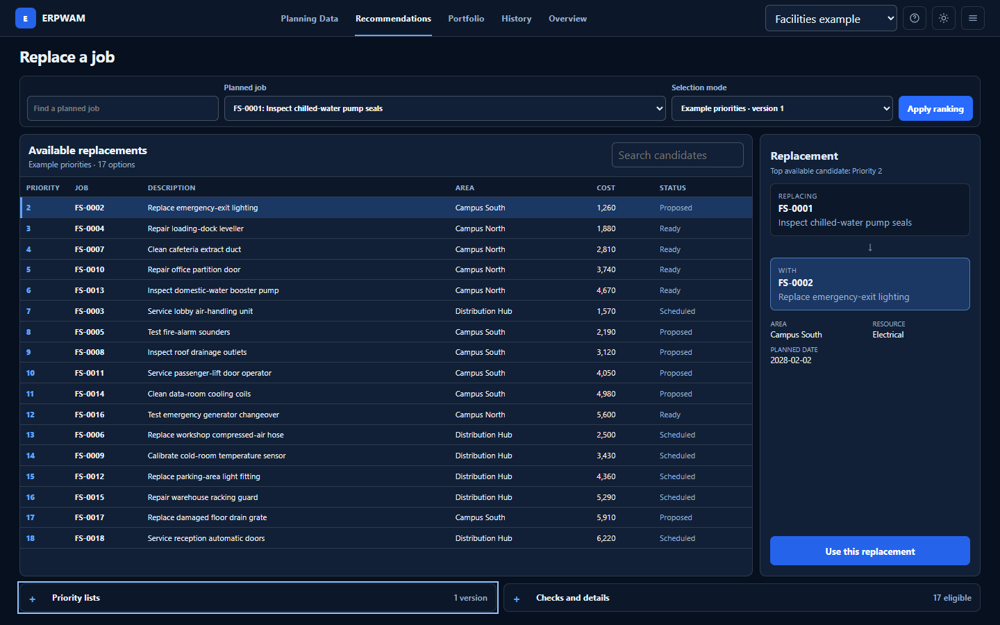

# ERPWAM

> Plan jobs, compare replacements, and keep the receipts. All in your browser.

Import an Excel schedule, map the columns, compare the options, and record what
you chose. ERPWAM helps maintenance and operations teams work through a
planning decision without handing that decision to a scoring model.

Priority Lists and direct human selection are first-class workflows. Eligibility checks, weighted scores, and the synthetic example model are advisory: they can explain and order candidates, but they do not remove the operator's authority to choose a loaded record.

**[Open ERPWAM](https://davidoffichw.github.io/ERPWAM/)**



## What you can do

- Import, map, edit, and export multi-sheet `.xlsx` planning workbooks.
- Preserve source columns and distinguish imported values from browser edits.
- Create or import Priority Lists without renumbering their declared ranks.
- Rank the same candidate population with a Priority List, transparent weights, or the synthetic demonstration model.
- Select any legitimate loaded replacement directly, including records carrying advisory warnings.
- Build a budget- and resource-constrained work portfolio.
- Record decisions, feedback, outcomes, scenarios, and corrected evidence.
- Keep multiple workspaces in browser-local storage and move them with a backup file.

Despite the name, ERPWAM is not a finance suite, enterprise ERP backend, or automated decision system.

## Try a decision

The built-in facilities and maintenance plans are fictional.

1. Open **Examples** in **Planning Data**, then choose **Facilities example**.
2. Choose **Recommendations**, then select the planned job to replace.
3. Make a direct choice, or create **Example priorities** under **Priority lists** and apply that ranking.
4. Select a replacement and choose **Use this replacement**.
5. Open **History** to inspect the recorded decision and its evidence.

Warnings stay attached to the data. They do not silently turn into eligibility gates.

The interface keeps the planning grid, candidate table, constraints, results, and decision history in the foreground. Column mappings, data issues, metric definitions, Priority Lists, and detailed evidence remain available when they are relevant without filling the everyday workspace.

## Run locally

Install Node.js 24.15 or newer and npm 11 or newer, then:

```bash
git clone https://github.com/DavidoffichW/ERPWAM.git
cd ERPWAM
npm ci
npm run dev
```

Open the local address printed by Vite. Press `Ctrl+C` to stop the server.

To build and preview the static application:

```bash
npm run build
npm run preview
```

The generated site is written to `dist/`. It needs no Python, application server, account service, or hosted database.

## Run the checks

Install the Chromium browser used by the end-to-end suite once:

```bash
npx playwright install chromium
```

On Linux, use `npx playwright install --with-deps chromium` when the browser libraries are not already installed.

```bash
npm run lint
npm run typecheck
npm test
npm run test:browser
npm run build
```

`npm run verify` runs linting, type checking, deterministic domain and adapter tests, and a production build. `npm run test:coverage` produces a local coverage report. GitHub Actions repeats the qualification on Windows and Ubuntu with Node.js 24.15; the manual Pages workflow runs the same qualification gate before deployment.

## Planning data and Excel

An imported worksheet becomes a versioned planning dataset with stable row and column identities. Column mappings state which source fields act as job ID, priority, cost, duration, resource, date, and other planning roles. Unknown columns remain part of the dataset.

Each cell keeps its original value and provenance separately from its current value. An exported ERPWAM workbook includes identity metadata so a later import can distinguish an ordinary scalar edit from a structural change. Structural changes, unsupported formulas, hidden planning sheets, unsafe ZIP paths, and oversized packages are rejected instead of being guessed through. Imported formulas are never executed by ERPWAM.

This is semantic round-trip support for the declared planning contract, not universal preservation of every Excel feature.

## The operator still decides

Every ranking method must return the complete, unique candidate population admitted by the decision context. Missing inputs leave a candidate visibly unranked; they do not remove it. Priority List ranks are preserved exactly, including gaps.

The weighted reference and synthetic linear model are explainable demonstrations. Their scores are not probabilities, policy decisions, or evidence of operational effectiveness. A human can select a loaded replacement without running either method.

## Portfolio optimization

For at most 20 candidates, ERPWAM enumerates every subset and reports global optimality under the stated objective, budget, and resource constraints. Larger populations use a deterministic bounded greedy heuristic. Approximate results are labeled as such and never claim a proven optimum. The heuristic does not add a non-positive-value job merely to fill spare capacity.

## Keep the receipts

Every saved decision keeps the context that produced it. Under the hood,
candidate scopes, rankings, portfolios, and cases carry revision and checksum
identities. A result tied to an older dataset snapshot cannot be silently
reused after mappings, rows, or relevant values change. Human decisions are
recorded as human events; no model result can overwrite them implicitly.

Portable case files and full application backups include integrity metadata. Corrupted or incompatible records fail closed.

## Browser storage and offline use

Workspaces are saved in IndexedDB under the current browser profile. Existing v0.1.0 application state and historical **Enterprise Resource Planner** backup envelopes remain readable. Storage is not encrypted, synchronized, or backed up automatically, so export a backup before clearing site data or changing browsers.

After a successful hosted load, the service worker keeps the application shell and fetched same-origin assets for later offline use. Online navigations prefer the current deployed shell, which avoids pinning a new deployment behind an old cached page. Offline mode can use only assets that were cached successfully; importing and exporting local workbooks still happens in the browser.

## Structure

- `src/contracts/` — data, decision, evidence, and persistence contracts
- `src/core/` — deterministic planning logic with no React dependency
- `src/web/` — React interface, Excel adapters, and IndexedDB persistence
- `tests/unit/` — domain, revision, ranking, portfolio, evidence, and service-worker checks
- `tests/integration/` — real workbook and IndexedDB adapter checks
- `tests/browser/` — Chromium workflows through the public UI
- `public/` — static assets, runtime manifest, and service worker

Exact installed dependency versions are recorded in `package-lock.json`. Third-party notices are in [THIRD_PARTY_NOTICES.md](THIRD_PARTY_NOTICES.md).

## Limits

ERPWAM does not provide organization-specific policy validation, encrypted team storage, remote collaboration, automatic synchronization, trained operational inference, or a guarantee that a recommendation is correct for a real facility. Use appropriate data controls and professional judgment before adopting a plan.

The hosted application uses the stable `/ERPWAM/` GitHub Pages path. The manual deployment workflow can also build for another repository subpath through `ERPWAM_BASE_PATH`.

## License

[MIT](LICENSE) © DavidoffichW

Release history is recorded in [CHANGELOG.md](CHANGELOG.md).
